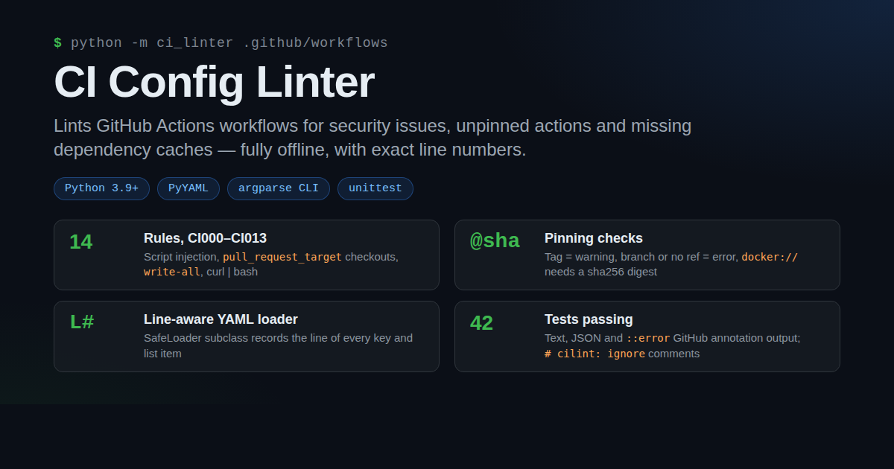

# CI Config Linter

A command-line tool that reads GitHub Actions workflow files (`.github/workflows/*.yml`)
and reports **security problems**, **unpinned actions** and **missing dependency caches**.
Every finding includes the file, line number, rule ID and job name.

It works fully offline. It needs no API keys and makes no network calls.

## Rules

| ID    | Name                    | Severity        | What it catches |
|-------|-------------------------|-----------------|-----------------|
| CI000 | parse-error             | error           | Invalid YAML or a file that is not a mapping |
| CI001 | unpinned-action         | warning / error | `uses:` on a tag (`@v4`) = warning; on a branch (`@main`) or with no ref = error; `docker://` image without a `sha256` digest |
| CI002 | script-injection        | error           | Untrusted event data (`github.event.issue.title`, `pull_request.body`, `github.head_ref`, …) put straight into `run:` or `actions/github-script` |
| CI003 | untrusted-checkout      | error           | A `pull_request_target` / `workflow_run` workflow that checks out the PR head |
| CI004 | missing-permissions     | warning         | No `permissions:` block, so `GITHUB_TOKEN` gets the default scopes |
| CI005 | excessive-permissions   | error / info    | `permissions: write-all`; broad `write` scopes at workflow level |
| CI006 | hardcoded-secret        | error / warning | Literal GitHub/AWS/Slack/Google/Stripe tokens and private keys; `*PASSWORD*`/`*TOKEN*` keys set to literal values |
| CI007 | missing-cache           | warning         | `setup-node`/`setup-python`/`setup-java`/`setup-go`/`setup-ruby` used with install commands but no cache |
| CI008 | self-hosted-runner-pr   | warning         | Self-hosted runner on a pull request trigger |
| CI009 | unsafe-commands         | error           | `ACTIONS_ALLOW_UNSECURE_COMMANDS: true` |
| CI010 | curl-pipe-shell         | warning         | `curl ... \| bash` style installs |
| CI011 | missing-timeout         | info            | Job without `timeout-minutes` (default is 6 hours) |
| CI012 | secrets-inherit         | warning         | `secrets: inherit` on reusable workflow calls |
| CI013 | invalid-structure       | error           | Missing `on`/`jobs`/`runs-on`, or a step with both or neither of `uses`/`run` |

Run `python -m ci_linter --list-rules` to see the same list in the terminal.

## Tech stack

- Python 3.9+ (tested on 3.12)
- [PyYAML](https://pypi.org/project/PyYAML/) 6.0.1 for parsing, with a custom loader that keeps line numbers
- Tests use the standard library `unittest` (no extra test packages)

## Setup

```bash
python3 -m venv venv
source venv/bin/activate
pip install -r requirements.txt
# optional: install the `ci-lint` command
pip install -e .
```

No configuration or environment variables are needed, so there is no `.env.example`.

## How to run

```bash
# Lint the current repo (looks in ./.github/workflows automatically)
python -m ci_linter

# Lint specific files or folders
python -m ci_linter path/to/repo .github/workflows/release.yml

# After `pip install -e .`
ci-lint .
```

### Options

| Flag | Meaning |
|------|---------|
| `-f, --format text\|json\|github` | Output format. `github` prints `::error file=...` annotations that show inline on PRs |
| `--min-severity info\|warning\|error` | Hide findings below this level |
| `--fail-on info\|warning\|error\|never` | Exit code 1 if any finding is at or above this level (default `warning`) |
| `--disable CI011,CI004` | Turn rules off (repeatable) |
| `--trusted-owner actions` | Skip SHA pinning checks for an owner (repeatable) |
| `--no-timeout-check` | Same as `--disable CI011` |
| `--no-color` | Plain output |
| `--list-rules` | Print all rules |

Exit codes: `0` = clean, `1` = findings at or above `--fail-on`, `2` = bad path or no workflow files.

### Suppressing findings

```yaml
steps:
  - uses: actions/checkout@v4   # cilint: ignore=CI001
  # cilint: ignore=CI010
  - run: curl -fsSL https://example.com/install.sh | bash
```

`# cilint: ignore` with no IDs hides every rule on that line.
`# cilint: ignore-file` anywhere in a file skips the whole file.

## Example usage

```text
$ python -m ci_linter examples/insecure
examples/insecure/pr-bot.yml
     8  ERROR    CI009 unsafe-commands: ACTIONS_ALLOW_UNSECURE_COMMANDS enables set-env/add-path, which allow environment injection
    10  ERROR    CI005 excessive-permissions: permissions: write-all grants write access to every scope
    16  ERROR    CI001 unpinned-action: Action 'actions/checkout@main' is pinned to branch 'main'; pin to a full commit SHA [job: greet]
    17  ERROR    CI003 untrusted-checkout: Workflow runs on 'pull_request_target' (has secrets and write token) but checks out untrusted pull request code [job: greet]
    20  ERROR    CI002 script-injection: Untrusted input '${{ github.event.pull_request.title }}' is interpolated into a run script; pass it through an env variable instead [job: greet]
    24  WARNING  CI010 curl-pipe-shell: Remote script is piped directly into a shell; download, verify a checksum, then execute [job: greet]
    33  WARNING  CI007 missing-cache: Job installs npm/yarn/pnpm dependencies but 'actions/setup-node' has no cache enabled and no actions/cache step is used [job: build]
    ...
1 file(s) checked: 6 error(s), 7 warning(s), 2 info

$ python -m ci_linter examples/secure
1 file(s) checked: 0 error(s), 0 warning(s), 0 info
```

JSON output for scripts:

```bash
python -m ci_linter examples/insecure -f json --min-severity error
```

### Use it in your own GitHub workflow

```yaml
- run: pip install -r requirements.txt
- run: python -m ci_linter . --format github --fail-on error
```

## Running the tests

```bash
python -m unittest discover -s tests -t .
```

## Project layout

```
ci_linter/
  loader.py     YAML loader that keeps line numbers
  models.py     Finding, Severity, Workflow/Job/Step wrappers
  rules.py      all lint rules (CI001-CI013)
  linter.py     runs rules, handles ignore comments, finds files
  reporters.py  text / json / github formats
  cli.py        argument parsing and exit codes
examples/       a secure and an insecure sample workflow
tests/          unittest test suite
```